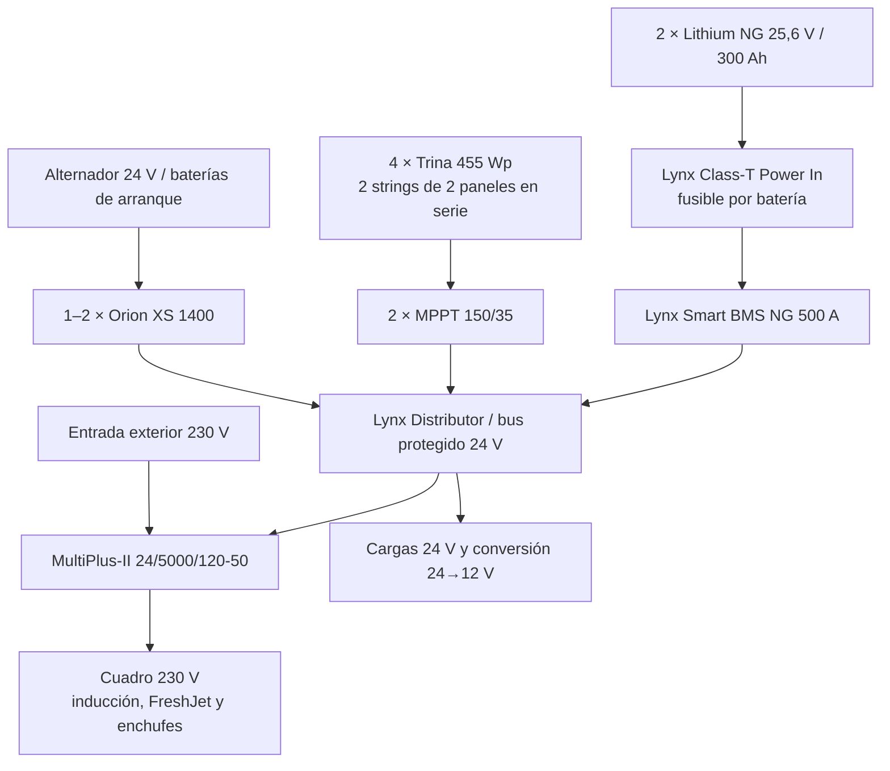

# Instalación eléctrica de la célula

**Estado:** propuesta preliminar, pendiente de cálculos, selección definitiva de protecciones y validación.  
**Actualizado:** 27 de noviembre de 2026.

Este documento recoge decisiones y candidatos para el sistema eléctrico de la célula del Mercedes-Benz Atego de expedición. **No implica que los componentes estén comprados o instalados.** No es un esquema de ejecución.

## Criterios de diseño

- Arquitectura principal a **24 V CC**, con cargas de **230 V CA** mediante inversor/cargador.
- Prioridad al ecosistema **Victron Energy** por compatibilidad y fiabilidad.
- **MultiPlus-II 24/5000** en lugar de Quattro 24/8000 para reducir el consumo en vacío.
- Cocina de **inducción de dos fuegos con limitador de potencia total** para evitar sobrecargar el inversor.
- Aire acondicionado previsto: **Dometic FreshJet FJZ7 2600**.
- Calefacción de la célula a **diésel**; agua caliente probablemente también a diésel.

## Componentes principales

| Función | Modelo | Unidades | Estado |
| --- | --- | ---: | --- |
| Solar | Trina Vertex S+ **TSM-455NEG9R.25**, 455 Wp | 4 | Previsto; **1.820 Wp** total |
| Batería de servicio | Victron **Lithium NG 25,6 V / 300 Ah** | 2 | Previsto; en paralelo, **600 Ah / 15,36 kWh nominales** |
| Inversor/cargador | Victron **MultiPlus-II 24/5000/120-50** | 1 | Modelo preferido; 5.000 VA nominales, no 5.000 W continuos |
| BMS | Victron **Lynx Smart BMS NG 500 A** | 1 | Propuesto |
| Protección por batería | Victron **Lynx Class-T Power In** | 1 | Propuesto; fusibles Class-T individuales pendientes de dimensionar |
| Distribución CC | Victron **Lynx Distributor** | 1, ampliable | Propuesto |
| Control solar | Victron **SmartSolar MPPT 150/35** | 2 | Propuestos; un controlador por cada pareja de paneles en serie |
| Carga desde alternador | Victron **Orion XS 1400** | 1, posible segundo | Propuesto; condicionado a capacidad del alternador |
| Monitorización | Victron **Cerbo GX MK2** | 1 | Propuesto |
| Pantalla | Victron **GX Touch 70** | 1 | Opcional |
| Conversión a 12 V | Victron **Orion 24/12**, variante por definir | Según cargas | Opcional |
| Cargas CC | Fusibles, distribución y posible Smart BatteryProtect | Por definir | Dimensionar por circuitos |
| Cocina | Placa de inducción de dos fuegos con limitación de potencia conjunta | 1 | Modelo por seleccionar |
| Aire acondicionado | Dometic **FreshJet FJZ7 2600** | 1 | Previsto |

## Diagrama funcional

El diagrama es **funcional**. Faltan conexiones de comunicación, seccionadores, fusibles de ramales, magnetotérmicos, diferenciales, puesta a tierra y cableado.

### Campo fotovoltaico

Dos strings independientes de **2 paneles en serie**, cada uno de **910 Wp**, con un **SmartSolar MPPT 150/35** dedicado. Esta opción aporta redundancia y separa el comportamiento de las sombras sobre diferentes zonas del techo. Antes de cerrar el diseño, verificar **Voc máxima en frío**, corriente, tensión de trabajo, sombras y compatibilidad real según fichas técnicas.

### Inversor y consumo

El **MultiPlus-II 24/5000/120-50** es la opción elegida frente al Quattro 24/8000 por su menor consumo en vacío. La vitrocerámica inicial se sustituye en los planes por **inducción con límite de potencia total configurable**. Un ajuste de unos **1,8–2 kW** mientras funciona el aire acondicionado es una hipótesis de diseño, **no** un límite validado. Se debe comprobar potencia activa/aparente simultánea y margen térmico del inversor.

Siempre que resulte práctico, elegir frigorífico, iluminación, bombas y otros consumos esenciales directamente a **24 V** para evitar mantener encendido el inversor innecesariamente. El MultiPlus-II elegido dispone de **una entrada CA**.

### Baterías y carga desde el motor

Las dos baterías Lithium NG forman un banco en **paralelo de 25,6 V nominales y 600 Ah**. Cada batería necesita su protección adecuada, con la conexión y los límites de corriente definidos por la documentación Victron.

La carga desde el alternador del Atego se haría mediante uno o dos **Orion XS 1400** manteniendo separadas las baterías de arranque y servicio. Número de equipos y corriente **pendientes** de conocer el alternador y sus otras cargas.

## Pendientes para el esquema de ejecución

1. Confirmar **potencia y capacidad libre del alternador** de 24 V del Atego.
2. Elegir placa de inducción y comprobar los **escalones de limitación de potencia total**.
3. Completar inventario y potencias de las cargas a **24, 12 y 230 V**.
4. Definir posiciones, distancias, ventilación, temperatura y sujeción de equipos y baterías.
5. Comprobar disposición física y sombras de los cuatro paneles respecto al FreshJet.
6. Diseñar **unifilar completo**, con secciones y longitudes de cables, fusibles CC de capacidad de corte adecuada, seccionadores FV, protecciones de CA, tierra y coordinación neutro-tierra con el MultiPlus.
7. Definir configuración del **Lynx Smart BMS NG**, control de cargadores, comunicaciones, límites de carga y descarga y seguridad por baja temperatura.
8. Validar manuales y normativa aplicable antes de comprar, instalar u homologar.

## Historial de decisiones

- **11 de noviembre de 2026:** se plantea la instalación con cuatro paneles Trina de 455 Wp, dos Victron Lithium NG 25,6 V / 300 Ah, FreshJet FJZ7 2600 y climatización/calefacción diésel, priorizando Victron.
- **11 de noviembre de 2026:** preferencia por el **MultiPlus-II 24/5000** en lugar del Quattro 24/8000 debido al consumo en vacío; inducción de dos fuegos con limitador de potencia conjunta.
- **27 de noviembre de 2026:** primeras especificaciones de la instalación recogidas en el repositorio.

Fuentes de contexto: decisiones expuestas en la conversación de diseño eléctrico del proyecto y [memoria de decisiones del camión](https://app.notion.com/p/415d8fb877fc81108e9df0fc4e07130f).
